# hemoflow-bench

**A nondimensional, multi-fidelity CFD benchmark for physics–ML surrogates of red-blood-cell (RBC) shear
encapsulation in microfluidic devices.**

High-fidelity CFD of RBC suspensions is too expensive to sample the joint design × patient space: one
cell-resolved or two-fluid simulation of a single microchannel geometry at a single flow rate costs minutes
to hours of compute, while a real device-optimisation question spans hundreds of geometries, flow rates and
synthetic patient blood profiles. `hemoflow-bench` attacks this **data-scaling bottleneck** directly: all
simulations are run in nondimensional ("star") units on validated 2D geometries, stored as analysis-ready
arrays, and used to train and benchmark multi-fidelity surrogates (PINNs, neural operators, Gaussian
processes) that answer the inverse design question — *for a given blood profile, which geometry and flow
rate maximise RBC drug encapsulation while keeping hemolysis below a safe threshold, and how robust is that
choice?*

The benchmark currently ships:

- a **legacy single-phase corpus** of 384 steady 2D OpenFOAM runs (366 converged) over six microfluidic
  geometry families, in Newtonian and Carreau shear-thinning rheologies, with a 30-run grid-convergence
  study and an axisymmetric validation against the Karino–Goldsmith benchmark ([details](docs/5-data.md));
- the **2023 COMSOL Euler–Euler study** (Nalla & Gereige) that motivated the current model
  hierarchy ([details](docs/6-comsol-2023.md));
- the full **mathematical model** in star units — single-phase non-Newtonian, continuum two-fluid, and the
  post-processing metrics (shear window, time-aware dose, hemolysis index, encapsulation index)
  ([details](docs/2-theory.md));
- **validation status** against published benchmarks (Wu 2015, Zhao 2008, Sezer 2026, Gracka 2022,
  Patrick, Fedosov 2010) ([details](docs/4-validation.md));
- a **cost analysis** (CPU-seconds per run, 2D vs 3D) that motivates the surrogate approach
  ([details](docs/7-scaling.md)).

All quantities are nondimensional star units: length scaled by the inlet height $h_1$, velocity by the mean
inlet velocity $U = Q/A$, viscosity by the high-shear plateau $\mu_\infty$, so $\rho^* = 1$, $\mathrm{Re}
= \rho U h_1/\mu_\infty$. The physical scale of the reference device (2023 work) is $h_1 = 50\,\mu\mathrm{m}$,
$U = 0.25\,\mathrm{m/s}$, $\rho = 1060\,\mathrm{kg/m^3}$, $\mu_\infty = 3.45\,\mathrm{mPa\cdot s}$, giving a
stress scale $\tau_{\mathrm{ref}} = \mu_\infty U/h_1 \approx 17.25\,\mathrm{Pa}$, $\mathrm{Re} \approx 3.8$ and
Carreau number $\mathrm{Cu} \approx 1.7\times10^4$. See [the theory chapter](docs/2-theory.md) for the general mapping.

## Gallery

### Flow through the six device families
Tracer particles advected in the simulated velocity field, coloured by the shear stress they experience
(the 30–60 Pa encapsulation band highlighted).

| Sudden expansion | Stenosis | Symmetric bifurcation |
|---|---|---|
| 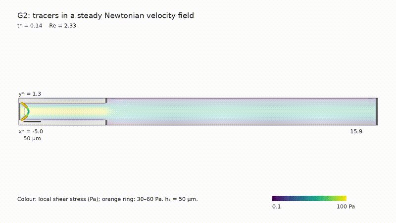 | 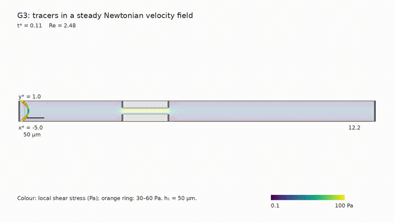 | 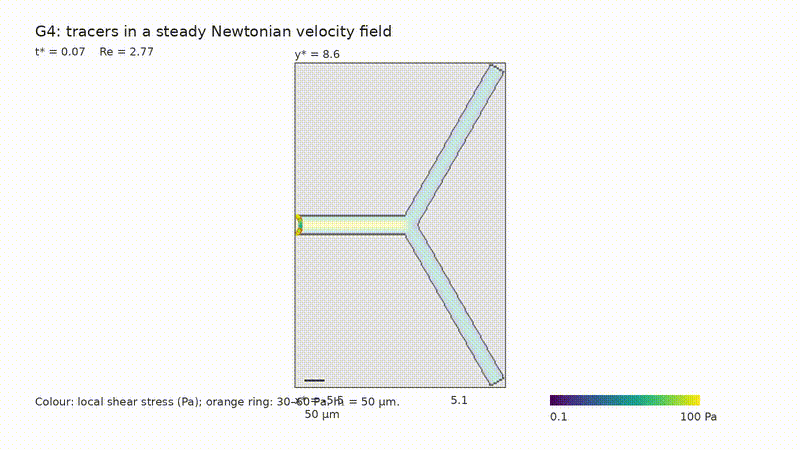 |
| **Asymmetric bifurcation** | **Serpentine** | **Network cell** |
| 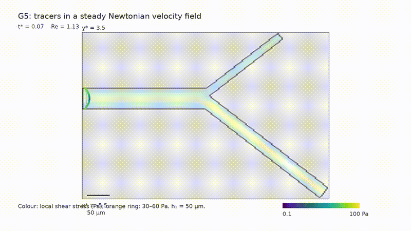 | 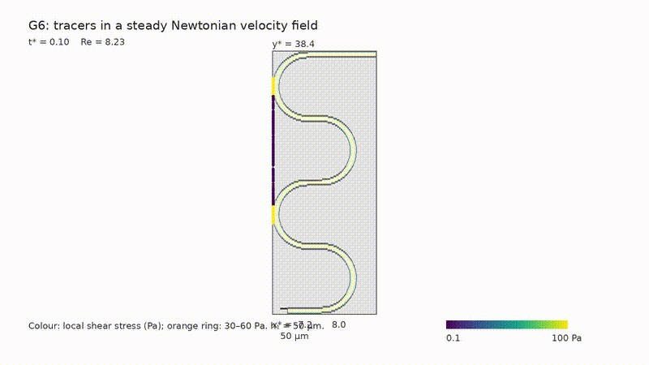 | 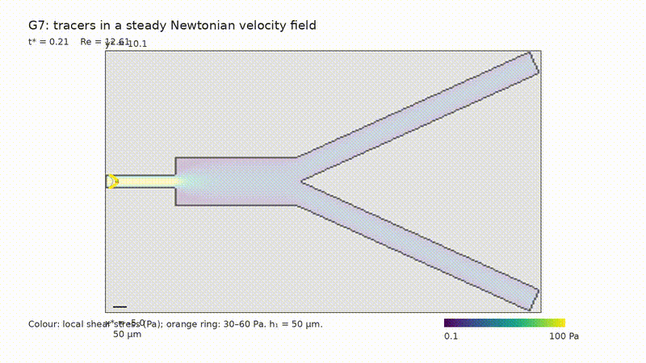 |

Full-HD versions: [`docs/animations/`](docs/animations/) (MP4).

### Fields, validation and convergence
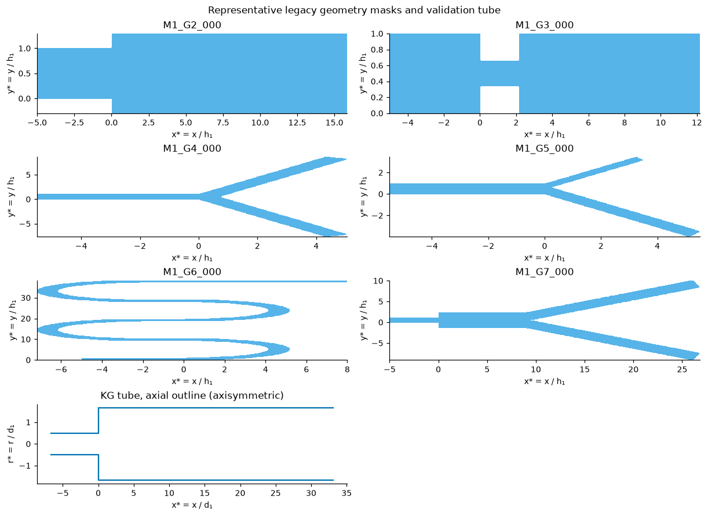
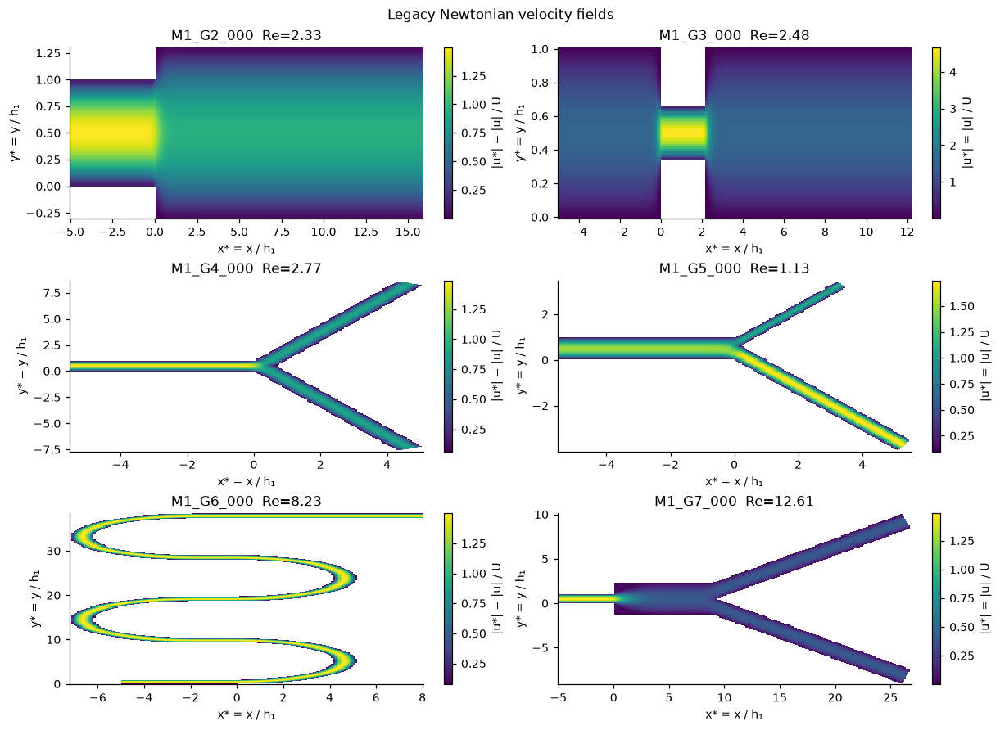
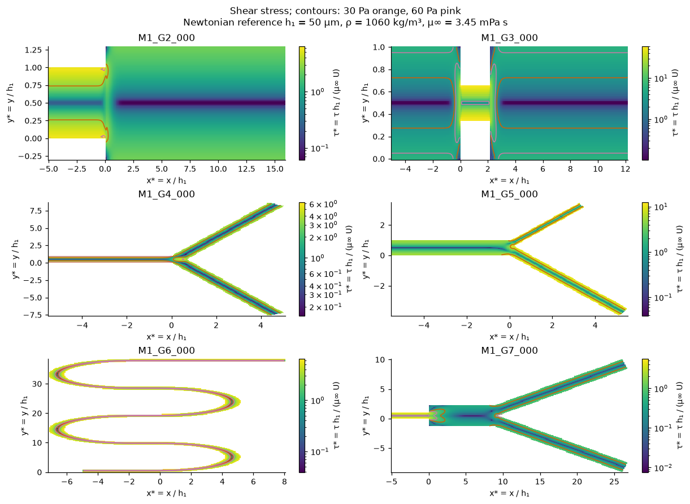

| Validation (Karino–Goldsmith tube vs Wu 2015) | Grid convergence (GCI) |
|---|---|
| 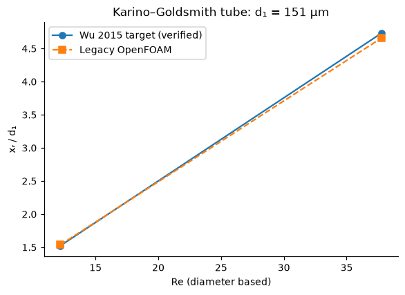 | 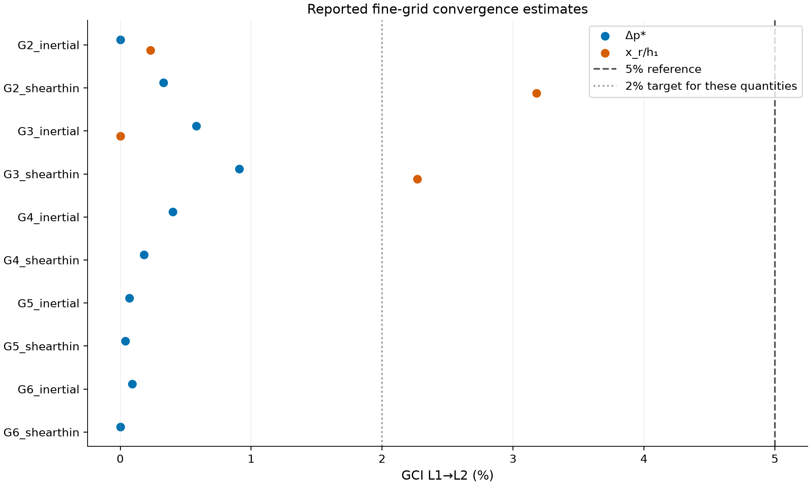 |

| 2023 COMSOL study (Nalla & Gereige) | Data-scaling: cost per run |
|---|---|
| 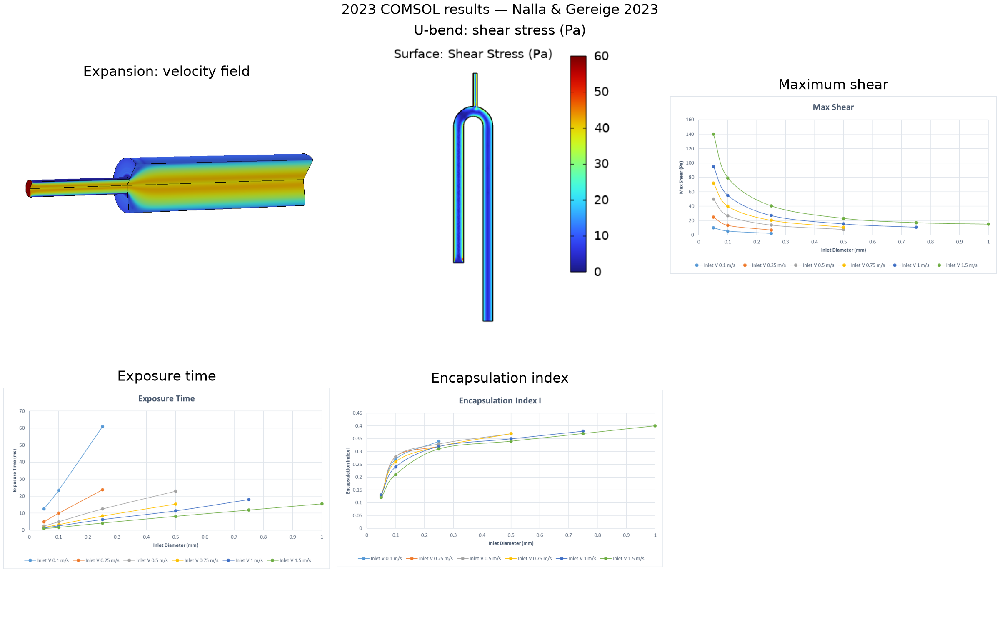 | 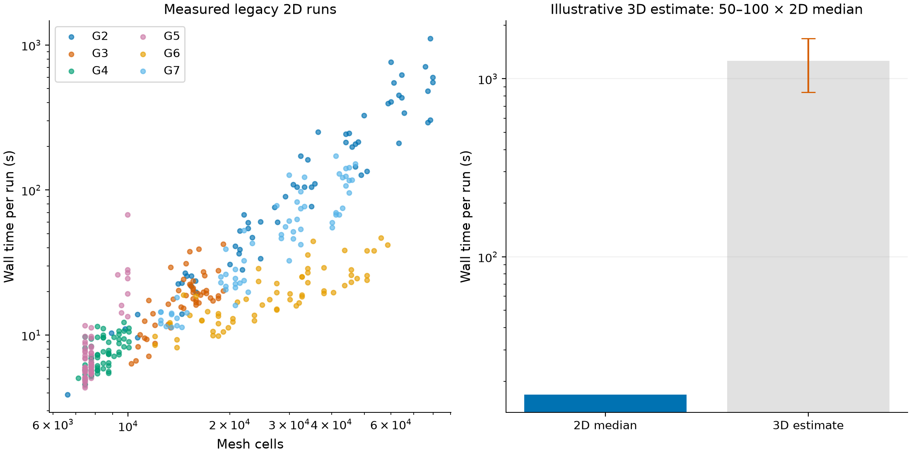 |

All figures and captions: [`docs/5-data.md`](docs/5-data.md).

## Repo map

| Path | What |
|---|---|
| `docs/` | handbook: problem, theory, methods, validation, data, 2023 COMSOL study, scaling, literature, decisions; figures and animations |
| `cfd/` | OpenFOAM case generators and validated cases (2D, star units); FEniCSx two-fluid solver and benchmarks |
| `campaign/` | sampling designs (Sobol), batch runners, grid-convergence (GCI) tooling, run manifests |
| `rbc/` | post-processing, dataset and evaluation library with tests |
| `pinn/` | physics-informed neural network benchmark on the legacy runs |
| `tools/portfolio/` | scripts that produce every figure and animation |
| `tests/` | unit and integration tests (`pytest`) |

Simulation data are not stored in git; they are published separately as a dataset.

## Status

- **Done (legacy):** 2D OpenFOAM pipeline validated (plane Poiseuille rel. L2 0.73 %; Karino–Goldsmith
  reattachment within 1.0–1.5 %); 30-run GCI study; 384-run single-phase M1 corpus (366 ok); 2023 COMSOL
  study documented. See [validation](docs/4-validation.md) and [data](docs/5-data.md).
- **In progress:** a paired four-variant corpus (Newtonian / Carreau / Euler–Euler drag+lift / Euler–Euler
  full, same mesh per design) with a steady FEniCSx two-fluid solver — no results are claimed here yet.
- **Planned:** surrogate training (S0 scalars, S1 fields, S2 multi-fidelity), Monte-Carlo uncertainty
  propagation, robust inverse design per synthetic patient blood vector, small 3D lattice-Boltzmann set.

Scope is **Stage A only**: encapsulation inside a microfluidic device. Drug release in the vasculature
(Stage B) is out of scope. No patient data is used anywhere: "patient blood profile" means synthetic
vectors sampled from published ranges.

## Credits

- **Sai Kiran Kumar Nalla** — author; 2023 COMSOL work and all simulation campaigns.
- **Elio Gereige** — co-author of the 2023 COMSOL study; credited wherever its figures or results appear
  ([2023 study](docs/6-comsol-2023.md)).

Every scientific claim in the handbook carries a source label (`verified / secondary / recalled`); nothing is invented. Full
citations with DOI/PMC identifiers: [literature](docs/8-literature.md).

## Documentation
Full handbook: [`docs/README.md`](docs/README.md).

## Licence
MIT — see [LICENSE](LICENSE).
